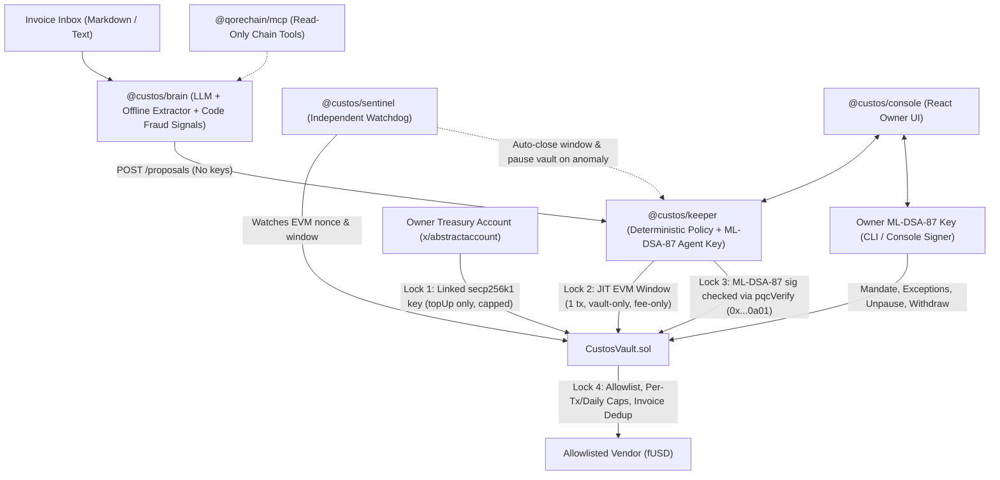

# Custos

**Post-quantum AI accounts-payable agent on QoreChain.**

Custos is an autonomous accounts-payable system built for QoreChain (`qorechain-diana` testnet). Its core security guarantee is structural rather than prompt-based:

> **Classical keys can only push money *toward* the vault. Only an ML-DSA-87 post-quantum signature—verified on-chain via QoreChain's `pqcVerify` precompile—can move money *out*.**

Even if an attacker completely fools the LLM with a prompt-injected invoice **and** steals the agent's classical secp256k1 (ECDSA) private key (a "Q-Day" compromise), funds remain protected by four independent, on-chain and off-chain defense layers.

---

## Hackathon Submission

Built for the [QoreChain Developer Fest "Build Before Q-Day"](https://build.qorechain.io/), track **Post-Quantum AI Agents**: *"Build an autonomous agent with spending and access limits enforced on chain."* Custos is the track's "bill payer" example, built from scratch during the event (4 Nov – 2 Dec 2026).

### Track requirements → where they live in the code

| Track requirement | How Custos meets it | Code |
| :--- | :--- | :--- |
| **Scoped EVM window** | The agent's EVM window stays closed between payouts. For each payout the Keeper opens a hybrid-signed window, sends one vault call, and closes it. | [`chain-real.ts` `openPayWindow` / `closeWindow`](packages/keeper/src/chain-real.ts#L176) |
| **Transaction, value, duration and target limits** | Every window is `maxTxs: 1`, `blocks: 50`, `maxValue` = the estimated fee + 20 % (no value transfer), `allowedTargets: [CustosVault]`. The vault adds its own per-payee, per-tx and daily caps. | [`WINDOW_PROFILE`](packages/core/src/config.ts#L35), [`CustosVault.pay`](contracts/src/CustosVault.sol#L113) |
| **Smart-account spending rules** | The treasury links a separate secp256k1 key through `x/abstractaccount` (`evm` permission only, 29-day expiry) with a spending rule that allows only `CustosVault.topUp(uint256)`, with per-tx and daily `fUSD` limits. The Keeper refills the vault through that key with `MsgExecuteEVM`. | [`setup.ts` step 7](packages/cli/src/setup.ts#L230), [`chain-real.ts` `topUp`](packages/keeper/src/chain-real.ts#L261) |
| **Authenticated messaging** | Every payout and owner instruction is a [QoreSign Message Signing v1](https://docs.qorechain.io/qoresign/spec/message-signing-v1) message signed with ML-DSA-87 and verified **on-chain** by the `pqcVerify` precompile against the key registered for the signer. The Solidity and TypeScript encoders are pinned byte-for-byte by shared test vectors. | [`CustosMessages.sol`](contracts/src/CustosMessages.sol#L23), [`encoding.ts`](packages/core/src/encoding.ts#L7), [`CustosVault._verify`](contracts/src/CustosVault.sol#L343) |

### Submission checklist

| Item | Status |
| :--- | :--- |
| Demo video (≤ 3 min) | _TODO: add link_ |
| `CustosVault` on testnet | _TODO: `0x…` — [explorer](https://explore.qore.network)_ |
| Owner / treasury address | _TODO: `qor1…`_ |
| Agent (Keeper) address | _TODO: `qor1…`_ |
| Example transactions | _TODO: a paid invoice, an owner-approved payout, and refused Attack Lab attempts (`npm run attack -- all --broadcast`)_ |
| Tests | 46 Foundry tests (incl. 512-run fuzzing) and 63 Vitest tests pass; `npm run live-check` passes against `qorechain-diana` |

---

## Table of Contents

- [Hackathon Submission](#hackathon-submission)
- [Why Custos?](#why-custos)
- [The Four-Lock Security Architecture](#the-four-lock-security-architecture)
- [System Architecture & Monorepo Layout](#system-architecture--monorepo-layout)
- [Smart Contracts & Post-Quantum Cryptography](#smart-contracts--post-quantum-cryptography)
- [QoreChain Testnet Configuration](#qorechain-testnet-configuration)
- [Quickstart](#quickstart)
  - [Prerequisites](#prerequisites)
  - [1. Install & Verify (Zero Cost)](#1-install--verify-zero-cost)
  - [2. Offline / Dry-Run Demo](#2-offline--dry-run-demo)
  - [3. Full Live Testnet Deployment](#3-full-live-testnet-deployment)
- [Sample Invoices & Demo Story](#sample-invoices--demo-story)
- [Attack Lab (Red-Team Verification)](#attack-lab-red-team-verification)
- [Owner CLI & Local Signer](#owner-cli--local-signer)
- [Keeper HTTP API Reference](#keeper-http-api-reference)
- [Configuration Reference](#configuration-reference)
- [Development & Testing](#development--testing)
- [Known Limitations](#known-limitations)
- [Credits](#credits)
- [License](#license)

---

## Why Custos?

Giving an AI agent access to a corporate wallet exposes two distinct failure modes:

1. **AI Manipulation (Prompt Injection & Social Engineering):** An adversarial invoice can embed hidden instructions (e.g., inside HTML comments) claiming bank details changed or a payment is pre-approved.
2. **Classical Key Compromise (Host Breach / Q-Day):** If an attacker obtains the agent's ECDSA private key, standard EVM accounts can be drained in a single transaction.

Custos eliminates both single points of failure by separating **reading** (the LLM Brain, which holds zero keys), **signing** (the deterministic Keeper, which enforces policy in code and holds the agent's ML-DSA-87 key), **monitoring** (the independent Sentinel watchdog), and **settlement** (`CustosVault.sol`, which enforces the owner's mandate and verifies ML-DSA-87 signatures on-chain).

---

## The Four-Lock Security Architecture



| Lock | Layer | Mechanism | What It Stops |
| :--- | :--- | :--- | :--- |
| **Lock 1** | **Treasury Smart-Account Rules** | QoreChain `x/abstractaccount` registers a dedicated secp256k1 linked key (`LINKED_KEY_PRIVATE_KEY`) with `evm`-only permission and spending rules restricting it exclusively to `CustosVault.topUp(uint256)` within per-tx and daily limits. | A compromised linked key can never drain the treasury—it can only push bounded `fUSD` *into* the vault. |
| **Lock 2** | **Just-in-Time Scoped EVM Windows** | Between payouts, the agent's EVM window is **closed**. For each payout, the Keeper opens a hybrid-signed Cosmos window scoped to `1` transaction, `50` blocks, fee-only value, targeting **only** `CustosVault`, and closes it immediately after. | A stolen agent ECDSA key cannot submit EVM transfers, ERC-20 `approve` calls, or arbitrary contract calls—even if it strikes while a payout window is open. |
| **Lock 3** | **On-Chain ML-DSA-87 Verification** | Every outflow from `CustosVault` requires an ML-DSA-87 (FIPS 204, NIST Level 5) signature verified on-chain via `pqcVerify` (`0x...0a01`) against the public key registered for `owner` or `agent` in `pqcKeyStatus` (`0x...0a02`, with `possessionProven == true`). | Forged signatures, classical-only attacks, and rotated/revoked keys are rejected directly in EVM execution. |
| **Lock 4** | **On-Chain Vault Mandate & Kill Switch** | `CustosVault` enforces vendor allowlists, per-payee caps, per-tx caps, rolling UTC daily caps, single-use nonces, expiries, and `invoiceHash` deduplication. Either the agent (Sentinel) or owner can `pause()`; **only the owner** can `unpause()`. | Fooled LLMs, bypassed Keepers, double-paid invoices, and out-of-policy payouts cannot move funds without an explicit owner ML-DSA-87 countersignature (`payApproved`). |

---

## System Architecture & Monorepo Layout

Custos is a TypeScript ESM monorepo (npm workspaces) paired with a Foundry smart-contract suite.

```text
qorechain/
├── contracts/                  # Foundry project (Solidity 0.8.28, Cancun EVM)
│   ├── src/
│   │   ├── CustosVault.sol     # Operating float vault enforcing Locks 3 & 4
│   │   ├── CustosMessages.sol  # QoreSign v1 message builders & domain tags
│   │   └── interfaces/
│   │       └── IQorePQC.sol    # QoreChain PQC precompile interfaces (0x...0a01, 0x...0a02)
│   └── test/
│       ├── CustosVault.t.sol   # Unit, fuzz, and vector-parity tests
│       ├── mocks/MockQorePQC.sol
│       └── vectors/custos-vectors.json
├── packages/
│   ├── core/                   # @custos/core — shared crypto, policy, ABI, encoding
│   ├── keeper/                 # @custos/keeper — agent signer, serialized executor, HTTP API
│   ├── brain/                  # @custos/brain — invoice parser (Claude + MCP or offline)
│   ├── sentinel/               # @custos/sentinel — independent anomaly watchdog & auto-pauser
│   ├── cli/                    # @custos/cli — keys, setup, status, owner CLI, Attack Lab
│   └── console/                # @custos/console — React 19 + Vite owner dashboard
├── invoices/
│   ├── README.md               # Guide to the sample invoices
│   └── inbox/                  # Drop Markdown/plain-text invoices here
├── scripts/
│   └── preload.mjs             # Node 22 ESM/CJS preload shim for CosmJS 0.39
├── custos.mandate.json         # Owner's declarative mandate & vendor directory
└── .env.example                # Environment variable template
```

### Package Breakdown

- **`@custos/core`**: Shared types, QoreChain `TESTNET` network config, ML-DSA-87 helpers wrapping `@qorechain/qoresign`, QoreSign v1 message encoders (byte-for-byte twin of `CustosMessages.sol`), deterministic `evaluateProposal()` policy engine, invoice hashing, unit conversions, and exported `CustosVault` ABI/bytecode.
- **`@custos/keeper`**: The **only** runtime process holding the agent's ML-DSA-87 key. Evaluates proposals against live on-chain vault state, manages serialized execution (one EVM window at a time), handles crash recovery on startup (`start()`), auto-tops-up the vault via `MsgExecuteEVM` when low, relays owner-signed operations without adding authority, and exposes a local `127.0.0.1` HTTP API.
- **`@custos/brain`**: Reads invoices from `invoices/inbox/`. Holds **zero keys**. Runs either with Claude (`ANTHROPIC_API_KEY`) augmented by a read-only subset of QoreChain's official `@qorechain/mcp` server (`get_address_info`, `get_pq_status`, `get_chain_info`, `read_contract`), or via a deterministic `--offline` extractor. Code-level fraud and prompt-injection detectors (`signals.ts`) are **always** merged into proposals so even a fooled model cannot strip them.
- **`@custos/sentinel`**: Independent watchdog polling the chain and comparing on-chain state against the Keeper's expected nonce and in-flight status. Detects three anomalies:
  - `foreign_window`: An open window scoped to anything other than `CustosVault` (or `nativeOnly`).
  - `unexpected_nonce`: On-chain EVM nonce exceeds what the Keeper recorded while idle.
  - `idle_window`: A window left open with no payout in flight.
  On detection, Sentinel raises an alert, closes any live window, and pauses `CustosVault` using the agent's ML-DSA-87 key (requiring the owner's ML-DSA-87 key to unpause).
- **`@custos/cli`**: Operational tooling for key generation (`keys`), idempotent testnet bootstrap (`setup:testnet`), live verification (`live-check`), four-lock inspection (`status`), owner signing & local signer daemon (`owner`), and red-team simulation (`attack`).
- **`@custos/console`**: Local React 19 + Vite web interface for the owner. Displays real-time status of all four locks along the money path, vault balance and daily remaining cap, pending out-of-mandate approvals (with one-click ML-DSA-87 approve/reject via the local owner signer), an unpause control, alarms for transactions the Keeper did not record, and an activity ledger with explorer links.

---

## Smart Contracts & Post-Quantum Cryptography

### `CustosVault.sol`

Deployed with immutable `owner`, `agent`, `token` (`fUSD` ERC-20, or `address(0)` for native `QOR`), `cosmosChainId`, and `requirePossessionProof`.

| Function | Required ML-DSA-87 Signer(s) | Purpose |
| :--- | :--- | :--- |
| `pay(intent, agentSig)` | `agent` | Settles an invoice inside the allowlist, per-payee cap, per-tx cap, and daily cap. |
| `payApproved(intent, agentSig, ownerSig)` | `agent` **and** `owner` | Settles an out-of-mandate invoice (new payee or over cap). Still blocked if `paused`. |
| `setPolicy(perTxCap, dailyCap, nonce, expiry, ownerSig)` | `owner` | Updates global per-tx and daily spending caps. |
| `setPayee(who, allowed, cap, nonce, expiry, ownerSig)` | `owner` | Adds, updates, or removes an allowlisted vendor and its cap. |
| `pause(nonce, expiry, sig, byOwner)` | `agent` **or** `owner` | Activates the kill switch, halting all payouts (`pay` and `payApproved`). |
| `unpause(nonce, expiry, ownerSig)` | `owner` | Resumes vault operations. |
| `withdraw(to, amount, nonce, expiry, ownerSig)` | `owner` | Withdraws funds from the vault back to an owner-specified address. |
| `topUp(amount)` | *None (pull-only)* | Pulls `amount` from `msg.sender` into the vault. Callable by the treasury's linked key. |

### QoreSign Message v1 & Domain Separation

Every ML-DSA-87 signature follows [QoreSign Message Signing v1](https://docs.qorechain.io/qoresign/spec/message-signing-v1):

```text
"qorechain-msg-v1|" || cosmosChainId || "|" || abi.encode(DOMAIN_TAG, block.chainid, address(vault), ...fields)
```

- **ML-DSA-87 Parameters (FIPS 204, NIST Level 5):** `algorithmId = 1`, public key = `2,592` bytes, secret key = `4,896` bytes, signature = `4,627` bytes.
- **Domain Tags:** `CUSTOS_PAY_V1`, `CUSTOS_APPROVED_PAY_V1`, `CUSTOS_POLICY_V1`, `CUSTOS_PAYEE_V1`, `CUSTOS_PAUSE_V1`, `CUSTOS_UNPAUSE_V1`, `CUSTOS_WITHDRAW_V1`.
- **Replay Protection:** Every message binds `cosmosChainId`, EVM `chainId`, `vault` address, a single-use `nonce`, and a Unix `expiry`. Payouts also mark `invoicePaid[invoiceHash] = true` (`keccak256` of invoice ID, payee, and amount).
- **Live Registry Check:** `_registeredKey(signer)` queries `pqcKeyStatus` (`0x...0a02`) on every call, so on-chain key rotations or revocations take effect immediately. Empty precompile return data is treated as `PrecompileUnavailable()`, never as a pass.
- **Cross-Language Parity:** `contracts/test/vectors/custos-vectors.json` pins `CustosMessages.sol` and `packages/core/src/encoding.ts` to identical byte outputs and is verified in both Foundry and Vitest.

---

## QoreChain Testnet Configuration

Custos targets the `qorechain-diana` testnet (configured in `packages/core/src/config.ts`):

| Parameter | Value |
| :--- | :--- |
| **Cosmos Chain ID** | `qorechain-diana` |
| **EVM Chain ID** | `9800` |
| **REST API** | `https://api-testnet.qore.host` |
| **Tendermint RPC** | `https://rpc-testnet.qore.host` |
| **EVM JSON-RPC** | `https://evm-testnet.qore.host` |
| **Block Explorer** | `https://explore.qore.network` |
| **Faucet** | `https://dashboard.qorechain.io/faucet` |
| **Native Denom** | `uqor` (6 decimals; min gas price `0.1 uqor/gas`, ~1.3 s blocks) |
| **`fUSD` ERC-20** | `0x97143B771D34ddb9130b807b135Ae675A5a963CA` (6 decimals; bank denom `erc20:0x97143B771D34ddb9130b807b135Ae675A5a963CA`) |
| **`pqcVerify` Precompile** | `0x0000000000000000000000000000000000000a01` (~330k gas for `CustosVault.pay`) |
| **`pqcKeyStatus` Precompile** | `0x0000000000000000000000000000000000000a02` |

---

## Quickstart

### Prerequisites

- **Node.js `>= 20.19`** (uses Node's native `process.loadEnvFile` and ESM loader)
- **Foundry (`forge`)** — required only if compiling or testing Solidity contracts (`npm run build:contracts`, `npm run test:contracts`). Developed with Foundry 1.9.0. Make sure `forge` on your `PATH` is Foundry's: an unrelated npm package is also called `forge`.
- **Optional:** An `ANTHROPIC_API_KEY` for Claude-powered invoice analysis (Custos works fully offline without one)

### 1. Install & Verify (Zero Cost)

```bash
npm install
npm run test:all
npm run live-check
```

`npm run live-check` connects to the live `qorechain-diana` testnet without spending any tokens and verifies:
1. `pqcVerify` (`0x...0a01`) and `pqcKeyStatus` (`0x...0a02`) are active.
2. `x/abstractaccount` is enabled and hybrid signatures are `required`.
3. EVM JSON-RPC responds with chain ID `9800`.
4. An ML-DSA-87 signature produced by the Keeper over a `CustosVault` pay message passes on-chain `pqcVerify`, while a 1-bit tampered message is rejected.

### 2. Offline / Dry-Run Demo

You can run the full workflow locally with `KEEPER_DRY_RUN=true` (the default) without deploying a vault or claiming faucet tokens. In dry-run mode, the Keeper signs real ML-DSA-87 messages, verifies them live against the testnet `pqcVerify` precompile, and simulates vault calls without broadcasting.

```bash
# Terminal 1 — Start the Keeper (dry-run by default)
npm run keeper

# Terminal 2 — Process the 4 sample invoices
npm run brain

# Terminal 3 — Open the Owner Console (http://localhost:5173)
npm run console
```

### 3. Full Live Testnet Deployment

#### Step 1: Generate Fresh Keys
```bash
npm run keys
```
Creates `.env` with three fresh keys:
- `OWNER_MNEMONIC` — Treasury / root ML-DSA-87 authority.
- `AGENT_MNEMONIC` — Keeper / agent ML-DSA-87 + ECDSA account.
- `LINKED_KEY_PRIVATE_KEY` — Dedicated secp256k1 key for Lock 1 treasury top-ups.
- Plus a random `KEEPER_API_TOKEN` protecting the local Keeper and Owner Signer HTTP APIs.

#### Step 2: Claim Testnet Tokens
Visit the [QoreChain Faucet](https://dashboard.qorechain.io/faucet) and claim tokens for your **`OWNER_COSMOS_ADDRESS`** printed by `npm run keys` (`100 QOR` + `1,000 fUSD` per 24 hours).

#### Step 3: Run Idempotent Testnet Bootstrap
```bash
npm run setup:testnet
```
Safe to re-run if any step is interrupted. It checks on-chain state and executes only what is missing:
1. Verifies owner `QOR` (≥ 30 QOR) and `fUSD` balances.
2. Registers the **owner's** ML-DSA-87 key with proof of possession.
3. Sends `20 QOR` to the **agent** for gas and window budgets.
4. Registers the **agent's** ML-DSA-87 key with proof of possession.
5. Converts bank `fUSD` into ERC-20 `fUSD` via `MsgConvertCoin`.
6. Opens a temporary owner EVM window, deploys `CustosVault`, saves `VAULT_ADDRESS` to `.env`, approves and funds the vault with initial `fUSD`, writes every allowlisted vendor from `custos.mandate.json` using owner ML-DSA-87 signatures, and closes the window.
7. Registers `LINKED_KEY_PRIVATE_KEY` on the owner's `x/abstractaccount` with `evm`-only permissions (29-day expiry; QoreChain requires re-linking at least every 30 days, so re-run setup after that) and spending rules restricting it exclusively to `CustosVault.topUp(uint256)`.

#### Step 4: Inspect All Four Locks
```bash
npm run status
```

#### Step 5: Go Live
Set `KEEPER_DRY_RUN=false` in `.env`, then launch the services in separate terminals:

```bash
# Terminal 1 — Keeper (agent signer + HTTP API on :8787)
npm run keeper

# Terminal 2 — Sentinel (watchdog polling every 10s)
npm run sentinel

# Terminal 3 — Owner local signer (on :8788, required for console Approve/Unpause buttons)
npm run owner -- serve

# Terminal 4 — Owner Console UI (http://localhost:5173)
npm run console

# Terminal 5 — Brain (reads invoices/inbox/ and proposes payouts to Keeper)
npm run brain            # add --watch to poll every 15s, or --offline / --no-mcp
```

---

## Sample Invoices & Demo Story

`invoices/inbox/` ships with four Markdown invoices designed to exercise every path through Custos:

| File | Vendor | Amount | Expected Outcome |
| :--- | :--- | :--- | :--- |
| `01-nimbus-INV-1042.md` | Nimbus Hosting *(allowlisted, cap 400)* | `120 fUSD` | **Paid automatically** inside the mandate via JIT window + agent ML-DSA-87 signature. |
| `02-lumen-INV-88.md` | Lumen Design Studio *(allowlisted, cap 400)* | `350 fUSD` | **Paid automatically** inside the mandate. |
| `03-nimbus-INV-2210.md` | "Nimbus Hosting" *(spoofed address)* | `4,800 fUSD` | **Flagged & Blocked.** Contains urgency pressure, "changed bank details", and a hidden prompt injection in an HTML comment. Brain flags it; Keeper escalates to owner approval; even if bypassed, `CustosVault` refuses the unknown address and cap violation. |
| `04-atlas-INV-5077.md` | Atlas Legal LLP *(new vendor)* | `600 fUSD` | **Needs Owner Approval.** Not on the allowlist and exceeds `perTxCap` (`500 fUSD`). Queued for owner ML-DSA-87 countersignature (`payApproved`) via `npm run owner -- approve <id>` or the Console. |

> Processed invoices are tracked by content digest in `data/brain-state.json`. Delete that file to re-process the inbox.

---

## Attack Lab (Red-Team Verification)

Custos includes an automated Attack Lab (`npm run attack`) that replays two real-world attack scenarios against your live testnet deployment:

```bash
# Safe simulation mode (no gas spent; uses eth_call & refused txs)
npm run attack -- all

# Run a specific scenario
npm run attack -- poisoned
npm run attack -- stolen-key

# Broadcast scoped-window attacks for real so refusals appear on the explorer
npm run attack -- all --broadcast
```

1. **`poisoned` (Compromised Brain + Bypassed Keeper):**
   - Submits a clean-looking proposal for `4,800 fUSD` to an attacker address with zero fraud flags (simulating a completely fooled LLM) → **Keeper refuses** and routes to owner approval.
   - Signs a valid agent ML-DSA-87 `PayIntent` directly and sends it to `CustosVault.pay` (simulating a bypassed Keeper) → **`CustosVault` reverts** with `PayeeNotAllowed` / `CapExceeded`.
2. **`stolen-key` (Q-Day — Attacker Holds Agent's ECDSA Key):**
   - Attempts a classical-only Cosmos `MsgSend` of native `QOR` → **Refused** (hybrid signatures required).
   - Attempts an EVM transfer to the attacker while the window is closed → **Refused** (no active EVM window).
   - With `--broadcast`, opens a real vault-scoped payout window and immediately attempts:
     - Native EVM transfer to the attacker inside the window → **Refused** (target not allowed).
     - `fUSD.approve(attacker, MAX)` inside the window → **Refused** (target not allowed).
     - `CustosVault.pay` with a forged 4,627-byte ML-DSA-87 signature inside the window → **Reverted** (`BadPQSig` via `pqcVerify`).

---

## Owner CLI & Local Signer

Because current QoreX wallet builds do not yet support arbitrary message signing (`signArbitrary`), `npm run owner` derives the owner's ML-DSA-87 key from `OWNER_MNEMONIC` identically to QoreX and signs QoreSign v1 messages locally. All signed operations are relayed through the Keeper (which adds no authority—`CustosVault` verifies the owner's ML-DSA-87 signature on-chain).

```bash
npm run owner -- pending                             # List pending out-of-mandate approvals
npm run owner -- approve <approval-id>               # Countersign with owner ML-DSA-87 key (payApproved)
npm run owner -- reject <approval-id>                # Reject a pending approval
npm run owner -- add-payee <0xAddr> <cap> [name]     # Allowlist a vendor (cap in whole fUSD)
npm run owner -- remove-payee <0xAddr>               # Revoke a vendor from the allowlist
npm run owner -- set-policy <perTx> <daily>          # Update global caps (in whole fUSD)
npm run owner -- unpause                             # Unpause the vault after a Sentinel/owner pause
npm run owner -- withdraw <0xAddr> <amount>          # Withdraw fUSD from the vault
npm run owner -- serve                               # Run local signer HTTP server for the Console (:8788)
```

> **Security Note:** `npm run owner -- serve` binds to `127.0.0.1`, strictly validates the `Origin` header against `CONSOLE_PORT`, and requires `KEEPER_API_TOKEN` in the `Authorization` header. It refuses to start if `KEEPER_API_TOKEN` is unset.

---

## Keeper HTTP API Reference

The Keeper binds to `127.0.0.1:${KEEPER_PORT}` (default `8787`). When `KEEPER_API_TOKEN` is set, all endpoints require `Authorization: Bearer <token>`.

| Method | Endpoint | Description |
| :--- | :--- | :--- |
| `GET` | `/health` | Health check (`{ "ok": true }`). |
| `GET` | `/status` | Live snapshot: mode, agent addresses & PQ key fingerprint, vault status, EVM window, nonces, pending payout, approval count, Lock 1 top-up info. |
| `GET` | `/activity?limit=100` | Reverse-chronological audit log of all payouts, window opens/closes, top-ups, alerts, and relays. |
| `GET` | `/approvals` | List of all approval records (pending, executed, rejected, failed) including `ownerMessage` hex to sign. |
| `GET` | `/vendors` | Token metadata and vendor directory loaded from `custos.mandate.json`. |
| `POST` | `/proposals` | Submit a payout proposal (`invoiceId`, `invoiceHash`, `payee`, `amount`, optional `vendorName`, `reason`, `flags`). |
| `POST` | `/approvals/:id/decision` | Approve (`{ approved: true, ownerSignature: "0x..." }`) or reject (`{ approved: false }`) a pending approval. |
| `POST` | `/pause` | Trigger an agent-signed `CustosVault.pause()` (`{ reason }`). |
| `POST` | `/relay` | Relay an owner-signed vault operation (`setPayee`, `setPolicy`, `unpause`, or `withdraw`). |
| `POST` | `/alert` | Record an alert raised by the Sentinel (`{ detail }`). |

---

## Configuration Reference

### Environment Variables (`.env`)

| Variable | Default | Description |
| :--- | :--- | :--- |
| `OWNER_MNEMONIC` | — | 24-word mnemonic for the owner/treasury account (ML-DSA-87 + ECDSA). |
| `OWNER_COSMOS_ADDRESS` | — | Bech32 Cosmos address of the owner treasury (used for Lock 1 top-ups). |
| `AGENT_MNEMONIC` | Public test mnemonic in dry-run | 24-word mnemonic for the agent/Keeper account. Required in live mode. |
| `LINKED_KEY_PRIVATE_KEY` | — | Hex secp256k1 private key for Lock 1 treasury `topUp` calls via `x/abstractaccount`. |
| `VAULT_ADDRESS` | — | Deployed `CustosVault` address (written automatically by `npm run setup:testnet`). |
| `VAULT_TOKEN` | `fUSD` (`0x9714...63CA`) | ERC-20 token address, or `native` / `qor` / zero address for tests. |
| `KEEPER_DRY_RUN` | `true` | `true` signs & verifies via `pqcVerify` without broadcasting; `false` executes live on testnet. |
| `KEEPER_PORT` | `8787` | Local HTTP port for the Keeper API. |
| `KEEPER_API_TOKEN` | — | Bearer token shared by Keeper, Brain, Sentinel, Console, and Owner Signer. |
| `OWNER_SIGNER_PORT` | `8788` | Local HTTP port for `npm run owner -- serve`. |
| `CONSOLE_PORT` | `5173` | Vite dev server port for `@custos/console` (whitelisted as CORS origin by Owner Signer). |
| `TOP_UP_AMOUNT` | `200` | Minimum `fUSD` amount to pull from the treasury when auto-topping up the vault. |
| `ANTHROPIC_API_KEY` | — | Optional. Enables Claude invoice analysis in `@custos/brain`. |
| `CUSTOS_MODEL` | `claude-opus-5-5` | Claude model ID used by `@custos/brain`. |
| `CUSTOS_DATA_DIR` | `data` | Directory for local state files (`keeper-state.json`, `brain-state.json`, `sentinel-state.json`). |
| `CUSTOS_MANDATE` | `custos.mandate.json` | Path to the owner's declarative mandate file. |

### Mandate File (`custos.mandate.json`)

Defines the owner's intended policy (written on-chain during `setup:testnet` and used as the Brain's vendor directory):

```json
{
  "token": "fUSD",
  "perTxCap": "500",
  "dailyCap": "1000",
  "payees": [
    {
      "name": "Nimbus Hosting",
      "address": "0x0Ba4629a70fa8BA79fA80f705ba9cA4A1AA4AB23",
      "cap": "400",
      "aliases": ["Nimbus Cloud", "nimbus-hosting.example"]
    }
  ]
}
```

---

## Development & Testing

| Script | Description |
| :--- | :--- |
| `npm test` | Run all TypeScript unit and integration tests via Vitest (`core`, `keeper`, `brain`, `sentinel`, `cli`). |
| `npm run test:contracts` | Run Foundry tests (`forge test -vv`) including fuzzing (512 runs) and vector parity checks. |
| `npm run test:all` | Run both Foundry contract tests and Vitest suites. |
| `npm run typecheck` | Run TypeScript type checking across the monorepo (`tsc --noEmit`). |
| `npm run build:contracts` | Compile `CustosVault.sol` and `CustosMessages.sol` with Foundry (`solc 0.8.28`, Cancun). |
| `npm run abi` | Export compiled `CustosVault` ABI & bytecode into `packages/core/src/vault-{abi,bytecode}.ts`. |
| `npm run vectors` | Regenerate `contracts/test/vectors/custos-vectors.json` from `@custos/core`. |
| `npm run build:console` | Build the production React bundle for `@custos/console`. |

### Note on `scripts/preload.mjs`

All Node CLI and service scripts run with `tsx --import ./scripts/preload.mjs ...`. CosmJS `0.39` is CommonJS and `require()`s ESM-only packages (`@scure/base`, `@noble/curves`), which triggers `ERR_REQUIRE_CYCLE_MODULE` on Node 22 if an ESM graph loads them first. `scripts/preload.mjs` imports `@cosmjs/stargate` and `@cosmjs/cosmwasm-stargate` upfront so module resolution completes cleanly.

---

## Known Limitations

- **QoreX cannot sign messages yet.** Current QoreX builds throw `QOREX_NOT_SUPPORTED_YET` for `signArbitrary`, so the owner's ML-DSA-87 key signs locally (`npm run owner`), derived from `OWNER_MNEMONIC` the same way QoreX derives it. The vault verifies the signature on-chain either way; the local signer is a stand-in until QoreX supports it.
- **The linked top-up key expires.** QoreChain requires re-linking at least every 30 days. Setup links it for 29 days; after that, re-run `npm run setup:testnet` (it only redoes missing steps). Payouts from the pre-funded vault keep working without it.
- **Testnet only.** `x/abstractaccount` is testnet-only for now, and the vendor addresses in `custos.mandate.json` are demo addresses.
- **The offline extractor reads simple Markdown and plain-text invoices.** PDFs and scans need the Claude path (`ANTHROPIC_API_KEY`).
- **The Sentinel reacts after the fact.** It closes windows and pauses the vault when it sees a transaction the Keeper did not send; prevention comes from the window scope and the vault's ML-DSA-87 checks, not from the Sentinel.
- **Local services trust localhost.** The Keeper, owner signer and console bind to `127.0.0.1` and share `KEEPER_API_TOKEN`; they are not meant to be exposed to a network.

---

## Credits

Custos uses these open-source libraries and QoreChain kits:

- **QoreChain kits:** [`@qorechain/sdk`](https://www.npmjs.com/package/@qorechain/sdk) 0.12.0 (accounts, hybrid signing, EVM windows, `x/abstractaccount` messages), [`@qorechain/evm`](https://www.npmjs.com/package/@qorechain/evm) 0.12.0 (testnet chain definition, window cost and rejection helpers), [`@qorechain/qoresign`](https://www.npmjs.com/package/@qorechain/qoresign) 0.1.1 (ML-DSA-87 and QoreSign message signing), [`@qorechain/mcp`](https://www.npmjs.com/package/@qorechain/mcp) 0.1.0 (read-only chain tools for the Brain).
- **Chain and crypto:** [viem](https://viem.sh), [CosmJS](https://github.com/cosmos/cosmjs) (`@cosmjs/stargate`), [cosmjs-types](https://github.com/confio/cosmjs-types).
- **AI:** [Anthropic TypeScript SDK](https://github.com/anthropics/anthropic-sdk-typescript) (Claude, tool runner), [Model Context Protocol TypeScript SDK](https://github.com/modelcontextprotocol/typescript-sdk), [Zod](https://zod.dev).
- **Contracts:** [Foundry](https://getfoundry.sh) and [forge-std](https://github.com/foundry-rs/forge-std) 1.17.0 (vendored in `contracts/lib/forge-std`, MIT/Apache-2.0).
- **Console and tooling:** [React](https://react.dev), [Vite](https://vite.dev), [TypeScript](https://www.typescriptlang.org), [tsx](https://tsx.is), [Vitest](https://vitest.dev). Fonts: [Spectral](https://fonts.google.com/specimen/Spectral) and [Public Sans](https://fonts.google.com/specimen/Public+Sans) (SIL Open Font License).

---

## License

MIT © 2026 The Custos authors. See [LICENSE](./LICENSE).
